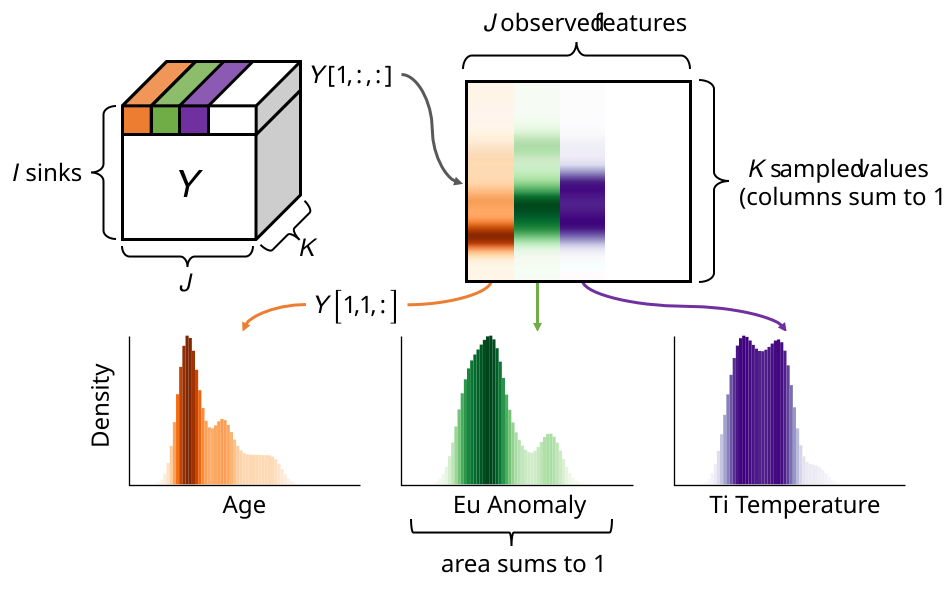
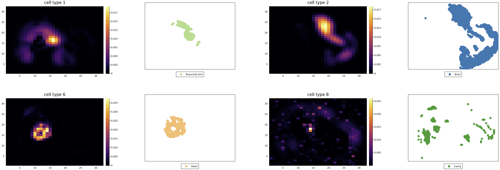
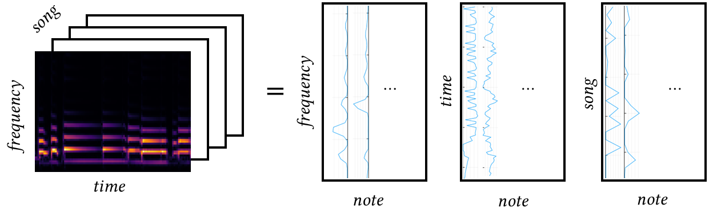

:::{#hero-heading}

Enjoyer of all things mathematical and musical; tech support for your data & science problems.

I'm currently a postdoc at McMaster University. Please reach out if you'd like to collaborate (academically or musically) and I would be happy to connect!

**Research Interests:** unsupervised learning, audio & signal processing, clustering, scientific computing, optimization, and tensor factorization.

### Education

2022 -- 2026 | PhD Applied Mathematics, University of British Columbia\
2020 -- 2022 | MMath Applied Mathematics, University of Waterloo\
2016 -- 2020 | BMath Mathematical Physics, University of Waterloo

{width="85%" fig-align="center"}

<!-- My main research interests include image & signal processing, musical applications, unsupervised machine learning, tensor factorization, and optimisation.  -->

<!--  -->

:::

<!--  -->

<!-- ## Recent Posts -->
<!-- Check out the latest &nbsp;[Papers](posts.qmd#category=paper)&nbsp;, &nbsp;[News](posts.qmd#category=news)&nbsp;, &nbsp;[Events](posts.qmd#category=event)&nbsp;, and &nbsp;[More »](/posts.qmd) -->

<!--
:::{#recent-posts}
:::

[All Posts »](/posts.qmd)

-->
